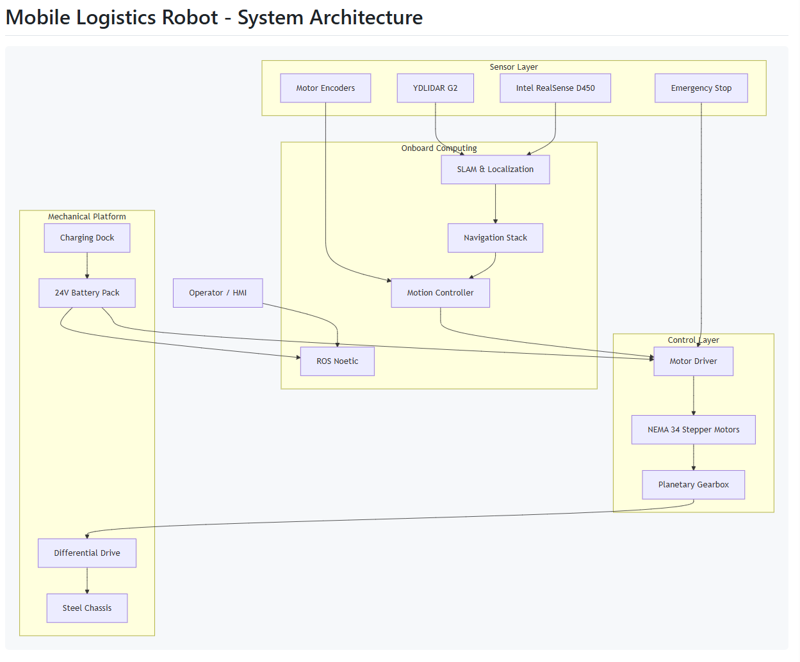
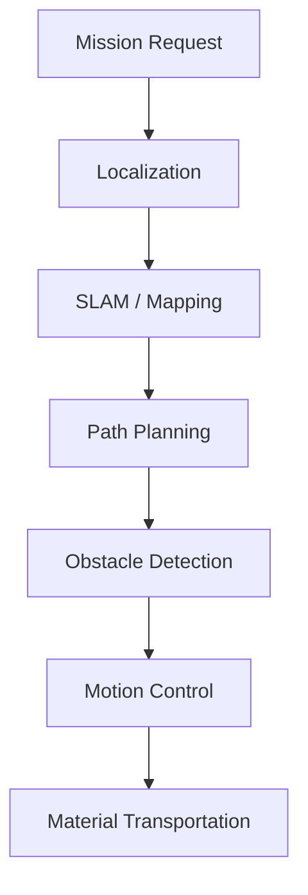
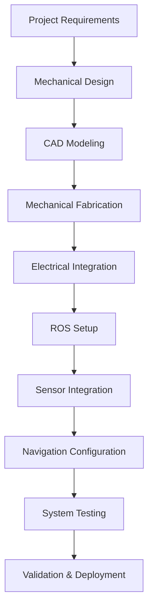
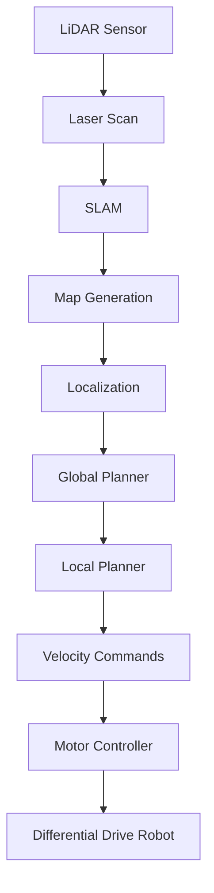
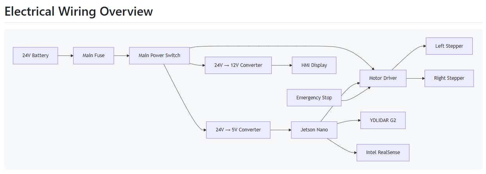
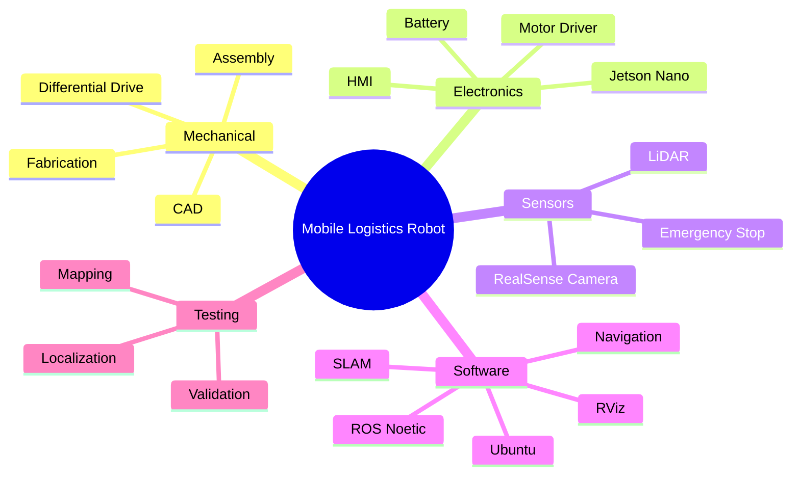
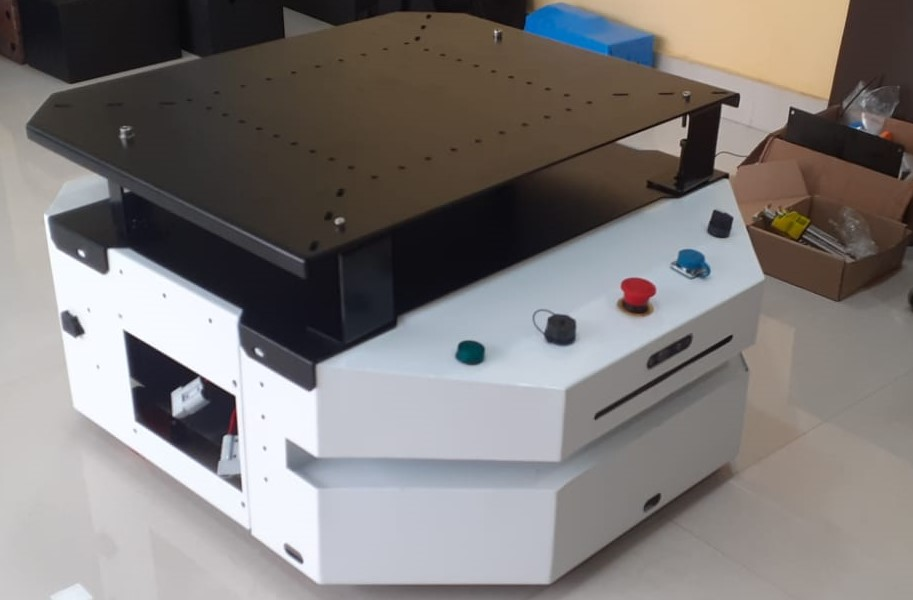
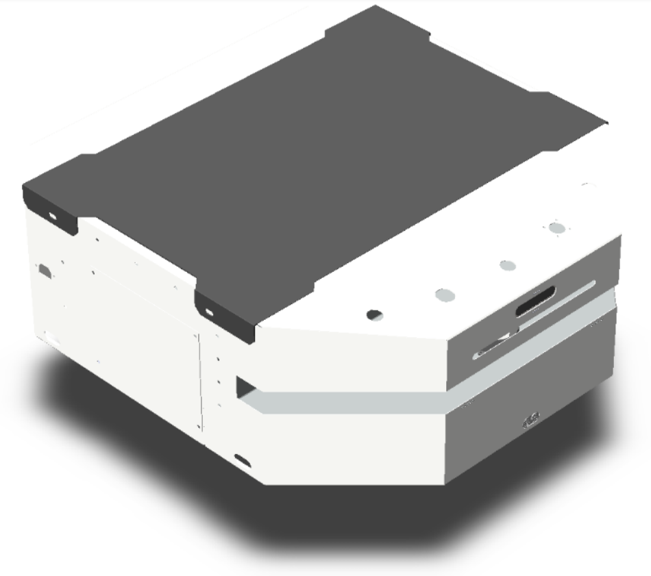
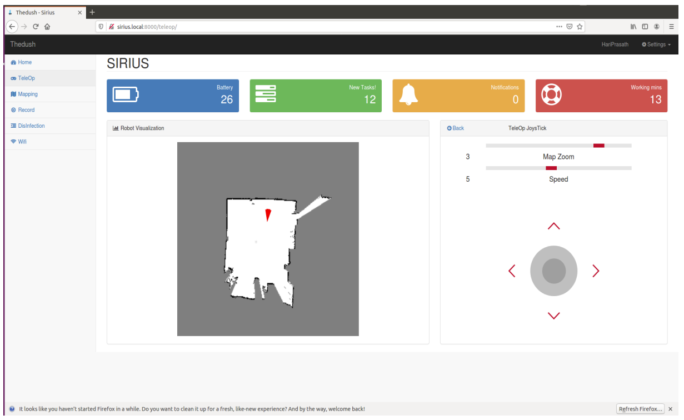

# Mobile Logistics Robot (AMR)

> Autonomous Mobile Robot (AMR) developed during an industrial internship for warehouse material transportation and industrial logistics automation.

> **⚠️ Note**
>
> This repository showcases the overall system architecture, hardware design, and development process.
>
> Due to a **Non-Disclosure Agreement (NDA)** signed with the organization, the ROS workspace, source code, CAD assemblies, firmware, navigation maps, and other proprietary implementation files cannot be made publicly available.

---

# Overview

This project involved the design, fabrication, integration, and validation of an **Autonomous Mobile Robot (AMR)** intended for indoor logistics and material transportation.

The robot was designed as a modular industrial platform capable of autonomous navigation using **LiDAR**, onboard computing, and the **Robot Operating System (ROS)**.

My contributions included:

- Mechanical Design
- CAD Modeling
- Hardware Selection
- Mechanical Assembly
- Electrical Integration
- ROS Integration
- LiDAR Integration
- Navigation Stack Setup
- Sensor Integration
- Robot Testing & Validation

---

# Project Pipeline


---

# Features

- Differential Drive Mobile Robot
- ROS-based Software Architecture
- LiDAR Mapping & Localization
- Autonomous Navigation
- Obstacle Detection
- Emergency Stop System
- Battery Powered Platform
- Charging Dock Support
- Industrial-grade Chassis
- Expandable Sensor Platform

---

# System Architecture



---

# Workflow



---

# Development Process



---

# Hardware

| Component | Purpose |
|------------|----------|
| NVIDIA Jetson Nano | Onboard Computing |
| YDLIDAR G2 | Environment Mapping & Localization |
| Intel RealSense Camera | Depth Perception |
| NEMA 34 Stepper Motors | Robot Locomotion |
| Planetary Gearbox | Torque Multiplication |
| Emergency Stop | Industrial Safety |
| HMI | Operator Interface |
| Lithium Battery | Power Supply |
| Charging Dock | Autonomous Charging |

---

# Software Stack

| Category | Technologies |
|-----------|--------------|
| Operating System | Ubuntu |
| Robotics Middleware | ROS Noetic |
| Visualization | RViz |
| CAD | PTC Creo |
| CAD | SolidWorks |
| CAD | Fusion 360 |
| Programming | C++, Python |

---

# Navigation Pipeline



---

# Mechanical Design

The robot employs a **Differential Drive** architecture consisting of:

- Two powered drive wheels
- Supporting caster wheels
- Polyurethane traction wheels
- Modular steel chassis
- Protective electronics enclosure
- Battery compartment
- Sensor mounting platform

---

# Electrical System

The electrical architecture consists of:

- Main Battery
- DC Power Distribution
- NVIDIA Jetson Nano
- Stepper Motor Driver
- LiDAR Sensor
- Intel RealSense Camera
- Emergency Stop Circuit
- Human Machine Interface (HMI)



---

# Technologies Used



---

# Safety Features

- Emergency Stop System
- Obstacle Detection
- Differential Drive Motion Control
- Collision Prevention
- Industrial Battery Protection
- Autonomous Navigation Safety

---

# Repository Structure

```text
Mobile-Logistics-Robot/
│
├── README.md
├── LICENSE
│
├── docs/
│   ├── architecture.png
│   ├── wiring_overview.png
│   └── screenshots/
│
├── images/
│   ├── final_robot.jpg
│   ├── cad_render.png
│   ├── rviz.png
│   ├── lidar_scan.png
│   └── hardware.jpg
│
└── media/
    └── demo.mp4
```

---

# Project Gallery

## Final Robot



---

## CAD Design



---

## LiDAR Mapping



---

# Skills Demonstrated

### Robotics

- Autonomous Mobile Robots (AMR)
- Differential Drive Systems
- Mobile Robot Design
- Industrial Automation

### Mechanical

- CAD Design
- Mechanical Assembly
- Fabrication
- Structural Design

### Software

- Robot Operating System (ROS)
- Ubuntu Linux
- RViz
- Python
- C++

### Sensors

- LiDAR Integration
- Depth Camera Integration
- Robot Localization
- SLAM

### System Engineering

- Hardware Selection
- Electrical Integration
- System Validation
- Industrial Testing

---

# Future Improvements

- Multi-Robot Fleet Coordination
- Autonomous Charging Scheduler
- Dynamic Obstacle Avoidance
- Cloud Monitoring Dashboard
- Warehouse Management System (WMS) Integration
- Fleet Management
- AI-based Task Scheduling
- ROS 2 Migration

---

# Confidentiality Notice

This repository serves as a professional portfolio highlighting the engineering work carried out during an industrial internship.

To comply with the signed **Non-Disclosure Agreement (NDA)**, the following items are intentionally excluded:

- ROS Workspace
- Source Code
- Launch Files
- Configuration Files
- CAD Assemblies
- Firmware
- Navigation Maps
- Internal Documentation
- Proprietary Algorithms

Only high-level architecture, hardware overview, system workflow, photographs, and non-confidential documentation are presented.

---

# Acknowledgements

Special thanks to the engineering team and mentors for providing the opportunity to work on the development of an industrial Autonomous Mobile Robot platform.

---

# License

This repository is licensed under the **MIT License**.

---

## ⭐ If you found this project interesting, consider giving it a star!
